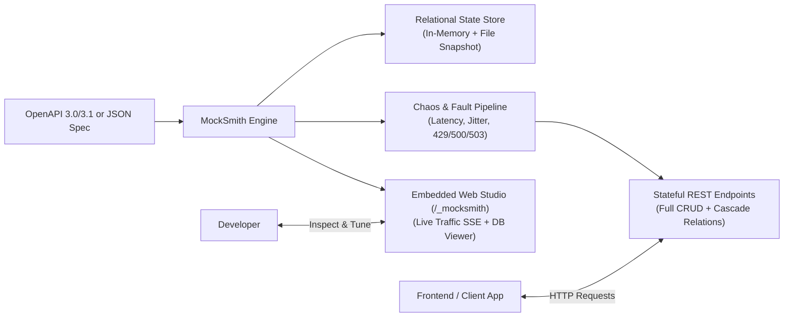

# MockSmith ⚒️

> **Zero-configuration stateful mock API server and network chaos sandbox.**  
> Turn static OpenAPI 3.0/3.1 specs or sample JSON into a live, relational REST backend with embedded real-time browser inspection and chaos simulation.

[]()
[](LICENSE)
[]()
[]()

---

## The Problem
1. **Static Schema Mocks are Dumb**: Tools like Prism or Stoplight only return static schema examples. If you `POST /api/users`, a subsequent `GET /api/users` does not contain the new user.
2. **Code-based Mocks are Tedious**: MSW (Mock Service Worker) is powerful, but developers must write and maintain dozens of repetitive TypeScript handlers.
3. **Flaky Network Testing is Manual**: Frontend developers rarely test edge cases (loading skeletons, 500 retries, 429 rate-limiting, expired bearer tokens) because simulating these conditions requires complex proxy setup.
4. **Postman Bloat & Privacy Risks**: Developers are increasingly rejecting bloated cloud-first tools that force account creation and risk leaking private tokens.

---

## The Solution: MockSmith
MockSmith bridges the gap between static dummy mocks and full backend implementations:



- **True State Persistence**: Supports full CRUD (`GET`, `POST`, `PUT`, `PATCH`, `DELETE`). Mutations persist in-memory across calls.
- **Relational Cascading**: Automatically handles nested sub-resources (e.g. `/api/users/:userId/orders` filters orders by `userId`).
- **Embedded Browser Dashboard**: View real-time SSE traffic streams, inspect in-memory database tables, and adjust network chaos sliders on the fly at `http://localhost:4000/_mocksmith`.
- **Zero Heavy Dependencies**: Pure Node.js / TypeScript, zero Docker requirement, 100% local-first and privacy-preserving.

---

## 🚀 Quickstart

### 1. Instant Demo (No file needed!)
Run an interactive demo store with pre-seeded `Users`, `Products`, and `Orders`:

```bash
npx mocksmith --demo
```

Open your browser:
* **API Endpoint**: `http://localhost:4000/api/users`
* **Web Studio Dashboard**: `http://localhost:4000/_mocksmith`

### 2. Ingest your OpenAPI Spec
Pass any OpenAPI 3.0/3.1 YAML or JSON document:

```bash
npx mocksmith ./openapi.yaml --port 8080
```

### 3. Ingest a Plain JSON Data Model
```bash
npx mocksmith ./db.json
```

---

## ⚡ Network Chaos & Fault Sandbox

Test frontend error states and resilience without touching backend code:

| Feature | Description | CLI Flag | Web UI Control |
| :--- | :--- | :--- | :--- |
| **Latency Injection** | Adds base artificial network latency | `-l, --latency <ms>` | Real-time Slider |
| **Latency Jitter** | Simulates real-world network fluctuations | `-j, --jitter <ms>` | Real-time Slider |
| **Failure Rate** | Injects probabilistic HTTP errors | `-e, --error-rate <0.0-1.0>` | Error % Slider |
| **Error Status** | Configure error code (`500`, `503`, `429`, `403`) | `-s, --status-code <code>` | Dropdown Select |
| **Auth Simulation** | Enforces `Authorization: Bearer <token>` | `--auth` | Checkbox Toggle |

### Example: Testing a 429 Rate Limit Flow
```bash
npx mocksmith --demo -l 800 -e 0.25 -s 429
```
* Every request incurs an 800ms delay.
* 25% of requests return `429 Too Many Requests` with automatic `Retry-After: 5` headers!

---

## 🖥️ Web Studio Dashboard (`/_mocksmith`)

MockSmith includes a built-in single-page browser console served directly by the server:

1. **Interactive API Dispatcher & Tester**: Send manual HTTP requests (`GET`, `POST`, `PUT`, `DELETE`) with JSON payloads and inspect response headers and timing directly in the browser—no Postman or curl needed!
2. **Live Traffic Stream with 1-Click Replay**: Watch incoming requests via Server-Sent Events (SSE). Click **Replay** to instantly re-execute any captured request, or click **Payload** to view diffs.
3. **In-Browser Database State Editor**: Live table viewer with tabs for each resource. Click **+ Add Record**, **Edit**, or **Del** directly in the table to mutate state on the fly.
4. **Contract Validation (400 Bad Request)**: Automatically validates incoming POST/PUT payloads against OpenAPI `required` properties, enums, and primitive types.
5. **Git-Friendly Collection Exports**: 1-click downloads for **OpenAPI 3.0.3 JSON** and **Bruno Collection** formats right from the top navigation bar.
6. **Chaos Sandbox**: Drag latency sliders and change failure rates live without restarting your server.

---

## 🛠️ CLI Reference

```
Usage: mocksmith [options] [spec]

Zero-configuration stateful mock API server and network chaos sandbox

Arguments:
  spec                        Path to OpenAPI YAML/JSON specification or raw JSON data model

Options:
  -V, --version               output the version number
  -p, --port <number>         Port to listen on (default: "4000")
  -l, --latency <number>      Base network latency injection in ms (default: "0")
  -j, --jitter <number>       Latency jitter in ms (default: "0")
  -e, --error-rate <number>   Chaos failure rate (0.0 to 1.0) (default: "0")
  -s, --status-code <number>  Chaos HTTP status code to inject (500, 503, 429) (default: "500")
  --auth                      Enable Bearer authorization simulation (default: false)
  --persist <path>            Persist state mutations to a local JSON file
  --demo                      Start instant interactive demo store (default: false)
  -h, --help                  display help for command
```

---

## 🧪 Testing & Verification

Run the full automated test suite (CRUD persistence, OpenAPI parsing, chaos injection, E2E HTTP, CLI process):

```bash
npm test
```

Build standalone distribution bundles:
```bash
npm run build
```

---

## 📜 Architectural Decisions & Principles
- **No Heavy Native Binaries**: Pure TypeScript implementation guarantees cross-platform execution on Linux, macOS, and Windows without native C++ compilation errors.
- **Local-First & Privacy First**: Zero telemetry, zero outbound analytics, zero cloud accounts required.
- **Strict REST Conventions**: Automatically returns `201 Created` for POST, `204/200` for DELETE, and standard RFC error envelopes for 4xx/5xx responses.

---

## License
MIT License. Built for developers who value speed, reliability, and great DX.
