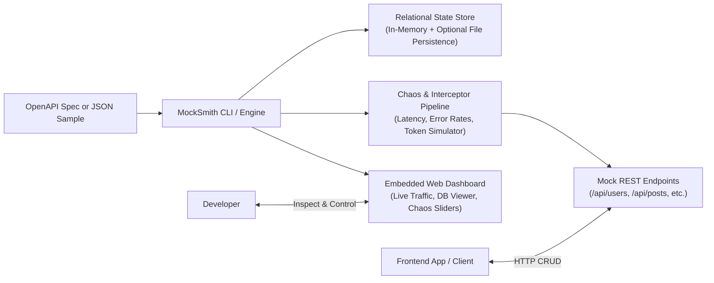

# MockSmith - Product Specification

## 1. Product Overview
**MockSmith** is a developer-first, zero-configuration stateful mock API server and network chaos sandbox. It transforms static OpenAPI/Swagger specifications or simple JSON samples into a fully functioning, stateful REST backend with relational integrity, live database inspection, and real-time network chaos simulation.

### Core Value Proposition
- **Stateful by Default**: Unlike static schema mocks (Prism) that only return hardcoded responses, `POST /api/items` actually adds an item to an in-memory relational database. Subsequent `GET`, `PUT`, and `DELETE` requests reflect real-world state transitions.
- **Zero-Boilerplate**: Ingests an OpenAPI 3.0/3.1 document or sample JSON without requiring developers to write dozens of mock handlers (eliminating the boilerplate of MSW).
- **Embedded Chaos Sandbox**: Built-in sliders for network latency, jitter, rate limiting (429), server errors (500/503), and auth token invalidation to test frontend resiliency.
- **Interactive Web Inspector**: An out-of-the-box browser dashboard showing live traffic, data table editing, and chaos controls in real time without restarting the mock server.

---

## 2. Target Users & Use Cases
1. **Frontend Engineers**: Develop and test full UI workflows (CRUD lists, pagination, form submissions, optimistic updates, error toasts) before backend endpoints are built.
2. **Fullstack Developers**: Rapidly prototype frontend apps with a mock API that acts like a real database-backed server.
3. **QA & Automated Testing**: Inject flaky network conditions, slow connections, and 4xx/5xx HTTP codes in CI or local regression tests to verify error handling.

---

## 3. Core Workflows

### Key User Journeys
1. **Instant Quickstart**:
   - Developer runs `npx mocksmith --demo` or `mocksmith spec.yaml`.
   - MockSmith parses endpoints, seeds initial mock data with smart type inference, and starts listening on `http://localhost:4000`.
   - Developer can immediately query `GET /api/users` and see realistic data.
2. **Stateful Mutations**:
   - Developer submits a form via `POST /api/users`. MockSmith validates required fields, assigns a generated ID, persists it in memory, and returns `201 Created`.
   - A subsequent `GET /api/users` contains the newly created record.
   - Calling `DELETE /api/users/:id` removes it from the store.
   - Calling `/api/users/:userId/posts` automatically cascades and filters posts belonging to `userId`.
3. **Resilience & Chaos Testing**:
   - Open `http://localhost:4000/_mocksmith` in the browser.
   - Drag the "Latency" slider to `1200ms` and set "Error Rate" to `20% 500 Internal Error`.
   - Developer verifies their frontend displays loading skeletons and retry banners gracefully.

---

## 4. Acceptance Criteria
- [x] **CLI Execution**: Starts with minimal flags (`mocksmith [file]`), has built-in `--demo` mode, configurable port, latency, and error rate.
- [x] **Stateful Relational Store**: Supports `GET (all)`, `GET (by id)`, `POST`, `PUT`, `PATCH`, and `DELETE`. Child resources (`/parents/:parentId/children`) inherit foreign key relations.
- [x] **Smart Data Synthesizer**: Generates contextual data based on schema property names (`id`, `name`, `email`, `avatar`, `price`, `createdAt`, `status`).
- [x] **Chaos Simulation**: Accurate latency injection, randomized error status codes, configurable failure probability, and auth token enforcement.
- [x] **Live Traffic & DB Dashboard**: Single-page web console served at `/_mocksmith` displaying:
  - Live HTTP request log with method, route, status code, latency, and payload diffs.
  - Interactive table viewer to inspect and reset database state.
  - Live controls to toggle chaos settings on the fly.
- [x] **Unit & Integration Test Suite**: Complete test coverage for REST operations, schema inference, relations, and chaos simulation.
